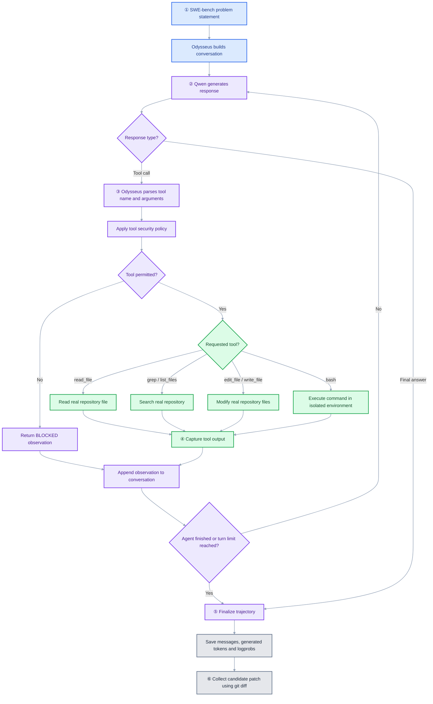
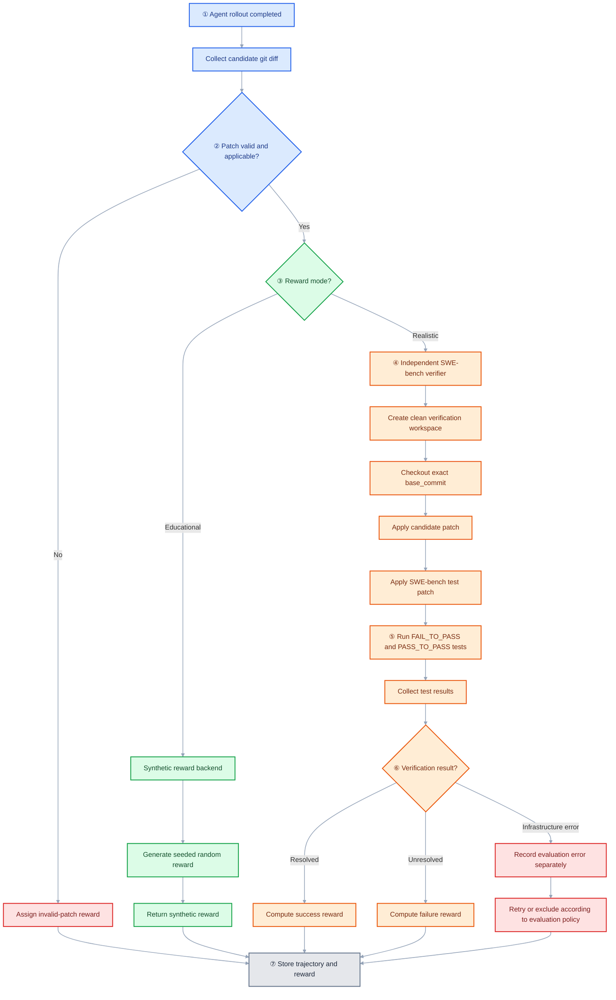
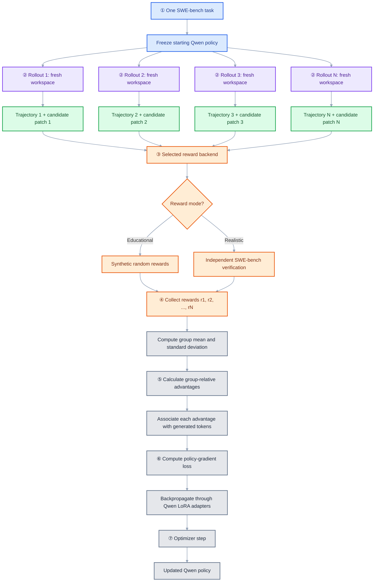

```mermaid
flowchart TD
    A["① Submit SWE-bench task"] --> B["Load task metadata"]
    B --> C["Extract repository, base_commit, issue text"]
    C --> D["② Prepare isolated execution workspace"]
    D --> E["Clone or locate repository"]
    E --> F["Checkout exact base_commit"]
    F --> G["③ Initialize Odysseus harness"]

    G --> H["Build system prompt and task context"]
    H --> I["Send conversation to local Qwen policy"]
    I --> J["Qwen generates response"]
    J --> K{"Tool call requested?"}

    K -->|Yes| L["Odysseus parses tool name and arguments"]
    L --> M["Apply tool security policy"]
    M --> N{"Tool permitted?"}
    N -->|No| O["Return BLOCKED observation"]
    N -->|Yes| P{"Requested tool"}

    P -->|read_file| Q["Read real repository file"]
    P -->|grep / list_files| R["Search real repository"]
    P -->|edit_file / write_file| S["Modify repository files"]
    P -->|bash| T["Run command in isolated environment"]

    Q --> U["Capture tool output"]
    R --> U
    S --> U
    T --> U
    O --> V["Append observation to conversation"]
    U --> V

    V --> W{"Agent finished or turn limit reached?"}
    W -->|No| I
    W -->|Yes| X["④ Finalize trajectory"]
    K -->|No| X

    X --> Y["Collect git diff"]
    Y --> Z{"Patch valid and applicable?"}

    Z -->|No| AA["Assign invalid-patch reward"]
    Z -->|Yes| MODE{"Reward mode?"}

    MODE -->|Educational| RAND["Generate synthetic random reward"]
    MODE -->|Realistic| AB["⑤ Send patch to independent verifier"]

    AB --> AC["Create clean verification workspace"]
    AC --> AD["Checkout base_commit"]
    AD --> AE["Apply candidate patch"]
    AE --> AF["Apply SWE-bench test patch"]
    AF --> AG["Run FAIL_TO_PASS and PASS_TO_PASS tests"]
    AG --> AH["Collect test results"]
    AH --> AI["Compute correctness reward"]

    AA --> AJ["Store trajectory and reward"]
    RAND --> AJ
    AI --> AJ

    AJ --> AK{"⑥ Remaining sampled rollouts?"}
    AK -->|Yes| D
    AK -->|No| AL["Compute group-relative advantages"]
    AL --> AM["Compute policy loss on generated tokens"]
    AM --> AN["Backpropagate through Qwen LoRA adapters"]
    AN --> AO["Optimizer step"]
    AO --> AP["⑦ Updated Qwen policy"]

    classDef prep fill:#DBEAFE,stroke:#2563EB,color:#1E3A8A,stroke-width:2px
    classDef agent fill:#EDE9FE,stroke:#7C3AED,color:#4C1D95,stroke-width:2px
    classDef tools fill:#DCFCE7,stroke:#16A34A,color:#14532D,stroke-width:2px
    classDef verify fill:#FFEDD5,stroke:#EA580C,color:#7C2D12,stroke-width:2px
    classDef learn fill:#E5E7EB,stroke:#64748B,color:#1E293B,stroke-width:2px

    class A,B,C,D,E,F prep
    class G,H,I,J,K,L,M,N,O,V,W,X agent
    class P,Q,R,S,T,U tools
    class Y,Z,AA,MODE,AB,AC,AD,AE,AF,AG,AH,AI verify
    class RAND tools
    class AJ,AK,AL,AM,AN,AO,AP learn

    linkStyle default stroke:#94A3B8,stroke-width:1.5px
```

# Irina — From Repository Repair to Learned Agent Behavior

Irina connects three parts of coding-agent research in one Python project: a **readable agent harness** that operates on real repositories, a **SWE-bench Verified repair workflow** that produces candidate patches, and **group-relative policy optimization (GRPO)** that trains a local Qwen model from rollout rewards. Its two modes are designed to share the same agent and optimization path: `educational` substitutes seeded synthetic rewards for expensive benchmark verification, while `realistic` requests results from the official SWE-bench evaluator. This distinction makes the system useful both for studying the mechanics of agent training and for developing a correctness-based evaluation workflow. Synthetic rewards do **not** measure software-repair quality.

> **Current status.** Irina has a Python agent harness, a local Qwen provider, and code for grouped SWE-bench rollouts and LoRA updates. Local validation covered source compilation, unit tests, and CLI smoke checks. It did **not** cover a complete Qwen training run, live SWE-bench dataset access, Docker-backed repository repair, or official benchmark evaluation. The code is a research prototype; it is not a validated benchmark result or a hardened autonomous coding service.

## 1. The Closed Loop: How a Repository Repair Becomes a Learning Signal

*The diagram lays out the intended route from a benchmark issue to a patch, a reward, and a policy update. It is a conceptual overview; some of its steps go beyond what has been exercised in an end-to-end run.*



The diagram connects **repository repair, evidence collection, and learning**. Qwen proposes actions; the Irina harness checks permissions, executes permitted tools against a task checkout, and returns observations for the next model turn. A rollout ends with a candidate Git diff, which is assessed by the selected reward backend. In `educational` mode, the seeded reward is **random and unrelated to patch correctness**; in `realistic` mode, the intended signal comes from independent SWE-bench verification. Multiple rollouts of the same task provide a comparison group, and the resulting advantages guide updates to Qwen's trainable LoRA parameters. This separation is a central design advantage: reward experiments need not change the agent's tool-execution logic.

### Inside the Agent: How Irina Turns Intent into Controlled Actions

This diagram gives a wider view of the agent than the benchmark pipeline does: entry points, workspace tools, permissions, saved conversations, and delegation all appear in one place. The code implements these concerns in separate modules, but not every connection in the drawing is wired as shown. In particular, resuming uses the last saved conversation snapshot, not replay of an interrupted tool call, and tool-call parsing currently accepts one XML-wrapped JSON call per model response.

At the heart of the implementation is a short loop: the provider generates text, Irina looks for a single structured tool call, the policy checks it, and the tool result goes back into the conversation. There are a few important differences between the diagram and the current code. `Harness.run` compacts the conversation **once before** entering the loop, using a character budget and retaining recent messages; it does not summarize with another model call before every turn. If the turn limit is reached, `agent_loop` returns `reason='turn_limit'` rather than making a separate tools-disabled final call. The diagram is therefore best read as a broader design, not a line-by-line trace.

```mermaid
flowchart TD
    START(["IRINA — Autonomous Coding Agent"])
    START --> ENTRY{"Execution entry point"}

    ENTRY -->|CLI| CLI["Parse CLI arguments and execution mode"]
    ENTRY -->|Python API| API["Construct Harness instance"]
    ENTRY -->|Fleet| FLEET["Schedule parallel agent jobs"]

    CLI --> INIT
    API --> INIT
    FLEET --> WORKERS["Create independent job harnesses"]
    WORKERS --> INIT

    INIT["Initialize Irina Harness"]
    INIT --> WORKDIR["Resolve and create working directory"]
    WORKDIR --> CONFIG["Configure model, tool registry and security policy"]
    CONFIG --> CORE["Register workspace tools and optional capabilities"]

    CORE --> RESUME{"Resume previous session?"}

    RESUME -->|Yes| LOAD["Load JSONL session history"]
    LOAD --> REPAIR["Tolerate torn final line and repair missing tool results"]
    REPAIR --> TASK

    RESUME -->|No| NEW["Create session when persistence is enabled"]
    NEW --> TASK["Receive task or continuation request"]

    TASK --> MEMORY["Load project memory from IRINA.md"]
    MEMORY --> SKILLS["Discover available skills"]
    SKILLS --> SYSTEM["Assemble system prompt and tool declarations"]
    SYSTEM --> APPEND["Append user message and persist when enabled"]

    APPEND --> TURN{"Normal turns remaining?"}

    TURN -->|Yes| TOKENS["Estimate conversation tokens"]
    TOKENS --> COMPACT{"Compaction eligible?"}

    COMPACT -->|Yes| SUMMARIZE["Summarize older messages using model"]
    SUMMARIZE --> KEEP["Keep recent messages and remove orphaned tool results"]
    KEEP --> MODEL

    COMPACT -->|No| MODEL["Request model completion"]

    MODEL --> PROVIDER["Provider sends system prompt, messages and tool schemas"]
    PROVIDER --> RESPONSE["Receive model response and token usage"]
    RESPONSE --> PARSE["Parse assistant text, function calls and signatures"]
    PARSE --> ASSISTANT["Append assistant message and emit event"]

    ASSISTANT --> CALLS{"Tool calls returned?"}

    CALLS -->|No| FINAL["Prepare final response"]
    CALLS -->|Yes| QUEUE["Process requested tool calls in order"]

    QUEUE --> NEXTCALL{"Another tool call?"}

    NEXTCALL -->|Yes| LOOKUP{"Known tool?"}
    LOOKUP -->|No| UNKNOWN["Return ERROR: unknown tool"]
    LOOKUP -->|Yes| POLICY["Evaluate security policy"]

    POLICY --> DENY{"Dangerous command?"}
    DENY -->|Yes| BLOCK["Return BLOCKED observation"]
    DENY -->|No| MODE{"Policy mode"}

    MODE -->|Read-only| READONLY{"Read-only operation?"}
    READONLY -->|Yes| DISPATCH
    READONLY -->|No| BLOCK

    MODE -->|Safe| SAFE{"Read operation?"}
    SAFE -->|Yes| DISPATCH
    SAFE -->|No| APPROVE{"User approves operation?"}
    APPROVE -->|Yes| DISPATCH
    APPROVE -->|No| BLOCK

    MODE -->|Yolo| DISPATCH{"Requested capability"}

    DISPATCH -->|read_file| READ["Read numbered file contents"]
    DISPATCH -->|write_file| WRITE["Create or overwrite file"]
    DISPATCH -->|edit_file| EDIT["Replace exactly one matching snippet"]
    DISPATCH -->|list_files / grep| SEARCH["Search repository files"]
    DISPATCH -->|bash| SHELL["Execute command in workspace"]
    DISPATCH -->|remember| REMEMBER["Append project memory"]
    DISPATCH -->|use_skill| SKILL["Load SKILL.md instructions"]
    DISPATCH -->|spawn_agent| DEPTH{"Sub-agent depth available?"}

    DEPTH -->|Yes| CHILD["Construct child harness with fresh context"]
    CHILD --> CHILD_RUN["Child executes delegated task"]
    CHILD_RUN --> CHILD_REPORT["Return child final report"]

    DEPTH -->|No| DEPTH_ERROR["Return depth-limit error"]

    READ --> OBS
    WRITE --> OBS
    EDIT --> OBS
    SEARCH --> OBS
    SHELL --> OBS
    REMEMBER --> OBS
    SKILL --> OBS
    CHILD_REPORT --> OBS
    DEPTH_ERROR --> OBS
    BLOCK --> OBS
    UNKNOWN --> OBS

    OBS["Capture tool result or exception as text"]
    OBS --> TOOLMSG["Append tool observation and emit events"]
    TOOLMSG --> SAVE["Persist observation when enabled"]
    SAVE --> NEXTCALL

    NEXTCALL -->|No| TURN

    TURN -->|No| LAST["Final model completion with tools disabled"]
    LAST --> LASTMSG["Append final assistant message"]
    LASTMSG --> FINAL

    FINAL --> SESSION_SAVE["Persist final message when enabled"]
    SESSION_SAVE --> REPORT(["Return task result to caller"])

    REPORT --> EXIT{"Execution mode"}
    EXIT -->|CLI / API| DONE(["Task complete"])
    EXIT -->|Fleet| AGG["Collect ordered job results"]
    AGG --> DONE

    classDef entry fill:#dbeafe,stroke:#2563eb,color:#1e3a8a,stroke-width:2px
    classDef reasoning fill:#ede9fe,stroke:#7c3aed,color:#4c1d95,stroke-width:1.5px
    classDef tools fill:#dcfce7,stroke:#16a34a,color:#14532d,stroke-width:1.5px
    classDef safety fill:#ffedd5,stroke:#ea580c,color:#7c2d12,stroke-width:1.5px
    classDef state fill:#f1f5f9,stroke:#64748b,color:#334155,stroke-width:1.5px
    classDef decision fill:#fef3c7,stroke:#d97706,color:#78350f,stroke-width:1.5px

    class START,CLI,API,FLEET,INIT,REPORT,DONE entry
    class MODEL,PROVIDER,RESPONSE,PARSE,SUMMARIZE,LAST reasoning
    class READ,WRITE,EDIT,SEARCH,SHELL,REMEMBER,SKILL,CHILD,CHILD_RUN,CHILD_REPORT tools
    class POLICY,BLOCK,APPROVE safety
    class WORKERS,WORKDIR,CONFIG,CORE,LOAD,REPAIR,NEW,TASK,MEMORY,SKILLS,SYSTEM,APPEND,TOKENS,KEEP,ASSISTANT,QUEUE,UNKNOWN,OBS,TOOLMSG,SAVE,LASTMSG,FINAL,SESSION_SAVE,AGG,DEPTH_ERROR state
    class ENTRY,RESUME,TURN,COMPACT,CALLS,NEXTCALL,LOOKUP,DENY,MODE,READONLY,SAFE,DISPATCH,DEPTH,EXIT decision
```



## 2. Establish the Runtime: Dependencies, Isolation, and Preflight Checks

Start with **Python 3.11 or 3.12** and `uv`, which manages the project environment and optional dependencies. A GPU is recommended for practical Qwen/LoRA training; a working Docker daemon is required by the configured isolated shell backend and realistic SWE-bench evaluation. Dataset downloads, model weights, source checkouts, and container images also require network access during setup. The `doctor` command checks prerequisites before you spend time on a rollout, while the test command checks the local Python implementation—not the full benchmark workflow.

```bash
# After downloading/extracting this archive:
cd Irina
uv sync --extra train --extra dev
uv run irina-grpo doctor
uv run pytest -q
```

If dependency resolution differs on your machine, refresh the lockfile with `uv lock` and consult `VALIDATION.md` for the precise scope of existing checks. The optional `realistic` extra installs the official SWE-bench package, but installation alone does **not** establish compatibility with its evaluator API or report format. A trustworthy realistic run still needs a compatible evaluator release, functioning Docker infrastructure, and an end-to-end benchmark test.

**Keep credentials out of `.env.example`, notebooks, commits, and logs.** An earlier supplied `.env` appeared to contain a credential; if it is still active, rotate it. Local Qwen training does not require a commercial inference API key, whereas the optional remote-provider path may require credentials.

## 3. Put Irina to Work: Inspect, Repair, Resume, and Delegate

```bash
uv run irina --help
export IRINA_API_KEY='your-rotated-key'
uv run irina -d ./my-project --mode read-only -p 'Inspect the code and summarize its architecture'
uv run irina -d ./my-project --mode safe -p 'Fix the failing tests'
uv run irina --resume -d ./my-project -p 'Continue the previous work'
uv run irina -d ./my-project --mode yolo --docker -p 'Run the unit tests'
uv run python -m irina.web -d ./my-project --port 3080
```

The agent CLI runs ordinary coding tasks; the GRPO CLI below runs training experiments. `read-only` blocks writes and shell commands. In `safe` mode, writes and shell commands require an approval callback; without one, those operations are denied. `yolo` skips that approval check but does not bypass the explicit command deny list. Shell execution still needs a configured `DockerSandbox`. The small web interface serves a local, read-only form and displays the result; it does not stream tool events or present browser approval controls.

## 4. Run the Learning Experiment: Tasks, Rollouts, and Checkpoints

```bash
uv run irina-grpo doctor
uv run irina-grpo tasks list
uv run irina-grpo tasks show django__django-11099
uv run irina-grpo run --mode educational --group-size 4 --max-agent-turns 4
uv run irina-grpo run --mode realistic --group-size 4
uv run irina-grpo inspect <run-id>
```

The GRPO CLI is the **experiment entry point**: by default it selects `Qwen/Qwen2.5-Coder-0.5B-Instruct`, `educational` rewards, and a group of four rollouts per task. Select a particular benchmark instance with `--task-index` or `--instance-id`, control reproducibility with `--seed`, and change the model or output location with `--model` and `--output-dir`. Each run groups its configuration, rollout trajectories, candidate diffs, summary, and LoRA checkpoint under `runs/<run-id>/` (`config.json`, `trajectory-N.json`, `patch-N.diff`, `summary.json`, `lora_checkpoint/`). These artifacts make experiments easier to inspect and compare, though they do not yet constitute a complete offline training replay record.

**Operational caveat:** The training path needs sufficient model and optimizer memory, while realistic verification can require substantial disk space and Docker image downloads. The official evaluator's API and report format must match the installed SWE-bench release. If evaluation infrastructure fails, record an error rather than interpreting it as a patch that failed tests. The pipeline is designed around real model generations and workspaces; the `educational` mode substitutes only the **reward signal**, not a fake model response.

## 5. Anatomy of an Attempt: From Model Decision to Candidate Patch

*This rollout diagram is retained verbatim from the supplied implementation prompt. It isolates the repeated model–tool exchange from the later reward and optimization stages.*



The code is split so that **model generation, tool execution, and training can be inspected separately**. `irina.loop.agent_loop` handles the model–tool exchange. `RemoteProvider` uses a remote OpenAI-compatible endpoint; `QwenProvider` is the local model adapter used by the training pipeline. `Tools` implements file operations, search, and Docker-backed shell execution, with symlink-aware workspace path checks. `Session` writes JSONL events and conversation snapshots, while `memory.py` reads `IRINA.md` and `skills.py` discovers `skills/*/SKILL.md`. Skill discovery is present, but the current harness does not register a general-purpose skill-loading tool. Context trimming uses a character budget rather than model-generated summaries. Sub-agent and fleet modules are present; the default security policy, however, only recognizes the six built-in tool names, so additional tools require deliberate policy changes.

### The Evidence Trail: What Each Trajectory Preserves

A trajectory is the **audit trail for one attempt at a repair**: its JSON records the conversation, generation events, requested tools, observations, stopping reason, and reward status. During training, the Qwen provider also retains generated and prompt token IDs **in memory**, allowing the optimizer to apply the policy-gradient objective to generated assistant tokens rather than prompt or tool-observation text. Old-policy token log probabilities are recomputed before the update. Because the JSON artifact does not serialize every token log probability, exact offline replay and distributed training would require a richer, versioned trajectory format.

## 6. What Counts as Success? Synthetic Feedback Versus Verified Repairs

*The reward-path diagram is preserved verbatim. It distinguishes a low-cost synthetic learning signal from independent benchmark verification; it is an architectural description, not a claim that the official evaluator has been validated end to end.*



The two reward paths serve **different research questions**. Seeded synthetic rewards make it possible to inspect grouping, advantage calculation, backpropagation, and checkpoint creation without claiming that the agent repaired anything. Official SWE-bench resolution status is intended to provide correctness-based feedback from a **clean verification environment separate from the agent's working tree**. An evaluator crash, missing report, or container failure is not equivalent to a legitimate unresolved patch; keeping those cases distinct is essential for interpretable experiments.

## 7. Learning by Comparison: Turning Competing Attempts into Policy Updates

*The grouped-rollout diagram is preserved verbatim. It shows how several attempts at the same task become one relative-learning update, rather than independent supervised examples.*



GRPO uses **relative performance within a group of rollouts**, rather than treating a reward in isolation. For rewards `r_i`, the rollout advantage is `A_i = (r_i - mean(r)) / (std(r) + epsilon)`; a group with zero reward variance produces zero advantages and therefore no meaningful learning signal. The same rollout advantage is associated with generated assistant tokens across its turns, and a clipped PPO/GRPO-style objective updates the Qwen LoRA adapters. This implementation is deliberately a research approximation, **not a claim of equivalence to every published GRPO variant**: reference-model KL is not enabled by default, and importance ratios, sequence weighting, and update stability need explicit validation before drawing scientific conclusions.

## 8. Experiment in Colab: What Runs, What Requires Docker

Open `notebooks/irina_grpo.ipynb` to follow the **same pipeline through a teaching-oriented Colab interface**. Set `REPO_URL` to the published repository and begin with `MODE = 'educational'` to inspect the experiment configuration and training path. Switching to `realistic` changes the reward backend; it does **not** provision Docker or guarantee evaluator compatibility. **Typical hosted Colab runtimes lack a working Docker daemon**, which also prevents the current Docker-backed agent shell tool from completing full rollouts there. Use a Docker-enabled GPU environment for that workflow, or develop a separately validated educational execution backend. The notebook references the README flowcharts because Mermaid fences in notebook Markdown are not rendered natively by Colab.

## 9. Find Your Way Through the Code: Interfaces and Responsibilities

The module interfaces below provide a **navigation map for contributors**: start at `Harness.run` for task execution, follow `agent_loop` into provider and tool calls, or start at `rl/pipeline.py` for grouped training runs. Each module's documentation describes its purpose, inputs, outputs, and a usage example. The table summarizes the intended API boundaries without implying that every integration path has been benchmark-verified:

| Module | Main interface | Inputs → outputs |
|---|---|---|
| `harness.py` | `Harness.run` | task str, max_turns int → result dict |
| `loop.py` | `agent_loop` | provider, tools, policy, messages → messages/events/reason dict |
| `provider.py` | `RemoteProvider.generate` | list[dict] → text/tokens dict |
| `providers/qwen.py` | `QwenProvider.generate` | list[dict] → text/token IDs dict |
| `tools.py` | `Tools.dispatch` | tool name str, args dict → observation str |
| `security.py` | `Policy.check` | tool name str, args dict → (bool, str) |
| `sandbox.py` | `DockerSandbox.run` | workspace Path, command str → stdout/stderr str |
| `context.py` | `compact` | messages list, max_chars int → messages list |
| `memory.py` | `read_memory` | workspace Path → memory str |
| `skills.py` | `discover_skills` | workspace Path → dict[str, Path] |
| `session.py` | `Session.append/read` | event dict → None / list[dict] |
| `subagent.py` | `delegate` | parent Harness, task str → result dict |
| `fleet.py` | `run_fleet` | jobs, factory → iterator[dict] |
| `web.py` | `main` | CLI flags → loopback HTTP service |
| `rl/tasks.py` | `load_task` | index int / instance_id str → SWETask |
| `rl/workspace.py` | `checkout` | repo str, commit str → Path context manager |
| `rl/rewards.py` | `synthetic_reward` | patch str, seed int, rollout int → RewardResult |
| `rl/rewards.py` | `realistic_reward` | SWETask, patch str, run_id str → RewardResult or error |
| `rl/training.py` | `train_group` | provider, records, rewards → training metrics dict |
| `rl/pipeline.py` | `run_pipeline` | Config → summary dict + files |
| `rl/cli.py` | `main` | command-line flags → JSON output |

## 10. Boundaries of Autonomy: Permissions, Isolation, and Trust

Irina's safety boundary combines **workspace path checks, tool policy decisions, and optional Docker isolation**. File operations resolve paths and symlinks before enforcing workspace containment. When shell execution is enabled, model-generated commands run in a Docker container with networking disabled, capabilities dropped, a read-only container root, CPU/memory/PID limits, and a writable bind mount of the task repository. That bind mount means the agent can still modify or destroy files **inside** its assigned workspace; Docker is not a guarantee against every escape or misconfiguration. Use disposable checkouts without secrets or elevated privileges, and perform any network-dependent image or repository preparation through a separate trusted setup process.

The important distinction is between **code that exists and behavior that has been tested**. The repository contains a Docker sandbox implementation, a training pipeline, and a benchmark reward adapter, but the local validation record does not establish that they work together on a real benchmark task. Check `VALIDATION.md` before interpreting an architectural diagram or a CLI command as a verified result.

## 11. Next Engineering Steps: Recovery, Replay, and Benchmark Validation

```bash
uv sync --extra dev
uv run pytest -q
uv run python -m compileall -q src
```

Custom functions can be registered with `@tool(description, parameter='...')` and passed through `Harness(extra_tools=[fn])`. They are **not automatically permitted**: `Policy.check` currently accepts only the six built-in names, so a custom tool also needs an explicit policy extension. The next practical work is to test Docker-backed rollouts on a real checkout, confirm the official evaluator's API and reports, and run a complete Qwen/LoRA update. After that, session recovery can be strengthened beyond completed snapshots, trajectory artifacts can capture enough token information for offline replay, and skills and delegated tools can be wired into the runtime. Keep benchmark solutions out of model prompts and training trajectories.

## 12. Reuse and Research Claims: Licenses, Evidence, and Validation

Check the repository's license and the licenses of any models, datasets, and external packages before redistributing a derived project. `VALIDATION.md` records which local checks passed and which model, Docker, and benchmark integrations still need to be exercised.
