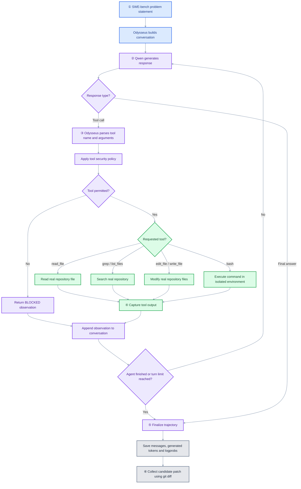
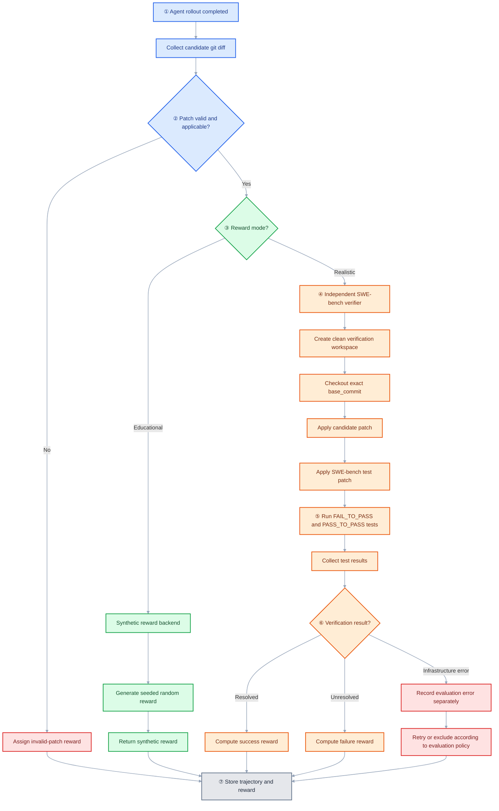
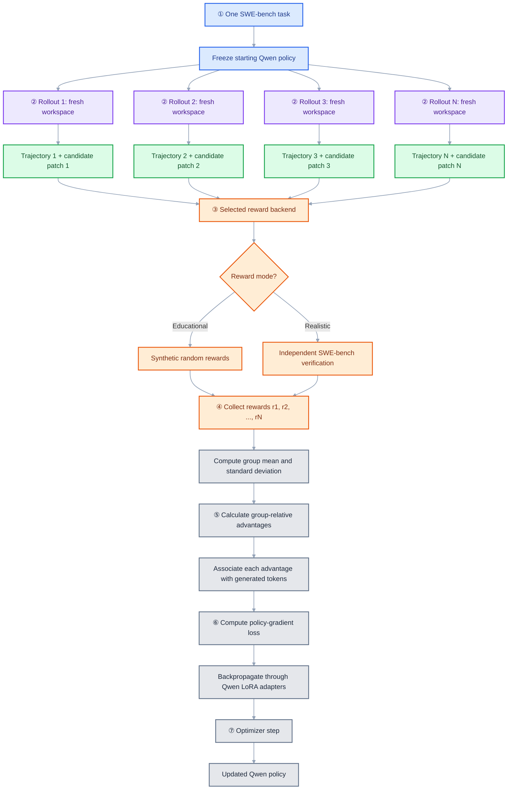

# Irina — coding agent + SWE-bench Verified + local Qwen + GRPO

Irina is a **Python coding-agent research implementation** combining a small, readable tool-using harness with a SWE-bench Verified software-repair experiment and group-relative policy optimization (GRPO). The default `educational` mode runs the **real agent and policy-gradient code** but replaces expensive SWE-bench test verification with seeded synthetic rewards. `realistic` mode calls the official SWE-bench evaluator instead. The only intended difference between the modes is reward provenance.

> **Verification and provenance notice.** The uploaded material contained an architectural README and an implementation specification, **not the original Odysseus source**. This distribution therefore contains an independently implemented Irina harness that follows the documented design, not a line-for-line port or verified feature-preserving rename. Some documented original behaviors (notably crash-resume in the middle of a tool call, SSE browser approvals, and fully integrated subagent skill loading) are not reproduced. The full model-backed and official verifier-backed flows have **not been executed in the packaging environment**. This is a research implementation requiring external models, Docker, and dataset access, not a security-certified autonomous coding product.

## 1. SWE-bench + Odysseus + Qwen + GRPO — Full pipeline

*Odysseus denotes the original harness architecture; its implementation in this project is named Irina. The diagram below is reproduced verbatim from the supplied implementation prompt.*

```mermaid
flowchart TD
    A["① Submit SWE-bench task"] --> B["Load task metadata"]
    B --> C["Extract repository, base_commit, issue text"]
    C --> D["② Prepare isolated execution workspace"]
    D --> E["Clone or locate repository"]
    E --> F["Checkout exact base_commit"]
    F --> G["③ Initialize Odysseus harness"]

    G --> H["Build system prompt and task context"]
    H --> I["Send conversation to local Qwen policy"]
    I --> J["Qwen generates response"]
    J --> K{"Tool call requested?"}

    K -->|Yes| L["Odysseus parses tool name and arguments"]
    L --> M["Apply tool security policy"]
    M --> N{"Tool permitted?"}
    N -->|No| O["Return BLOCKED observation"]
    N -->|Yes| P{"Requested tool"}

    P -->|read_file| Q["Read real repository file"]
    P -->|grep / list_files| R["Search real repository"]
    P -->|edit_file / write_file| S["Modify repository files"]
    P -->|bash| T["Run command in isolated environment"]

    Q --> U["Capture tool output"]
    R --> U
    S --> U
    T --> U
    O --> V["Append observation to conversation"]
    U --> V

    V --> W{"Agent finished or turn limit reached?"}
    W -->|No| I
    W -->|Yes| X["④ Finalize trajectory"]
    K -->|No| X

    X --> Y["Collect git diff"]
    Y --> Z{"Patch valid and applicable?"}

    Z -->|No| AA["Assign invalid-patch reward"]
    Z -->|Yes| MODE{"Reward mode?"}

    MODE -->|Educational| RAND["Generate synthetic random reward"]
    MODE -->|Realistic| AB["⑤ Send patch to independent verifier"]

    AB --> AC["Create clean verification workspace"]
    AC --> AD["Checkout base_commit"]
    AD --> AE["Apply candidate patch"]
    AE --> AF["Apply SWE-bench test patch"]
    AF --> AG["Run FAIL_TO_PASS and PASS_TO_PASS tests"]
    AG --> AH["Collect test results"]
    AH --> AI["Compute correctness reward"]

    AA --> AJ["Store trajectory and reward"]
    RAND --> AJ
    AI --> AJ

    AJ --> AK{"⑥ Remaining sampled rollouts?"}
    AK -->|Yes| D
    AK -->|No| AL["Compute group-relative advantages"]
    AL --> AM["Compute policy loss on generated tokens"]
    AM --> AN["Backpropagate through Qwen LoRA adapters"]
    AN --> AO["Optimizer step"]
    AO --> AP["⑦ Updated Qwen policy"]

    classDef prep fill:#DBEAFE,stroke:#2563EB,color:#1E3A8A,stroke-width:2px
    classDef agent fill:#EDE9FE,stroke:#7C3AED,color:#4C1D95,stroke-width:2px
    classDef tools fill:#DCFCE7,stroke:#16A34A,color:#14532D,stroke-width:2px
    classDef verify fill:#FFEDD5,stroke:#EA580C,color:#7C2D12,stroke-width:2px
    classDef learn fill:#E5E7EB,stroke:#64748B,color:#1E293B,stroke-width:2px

    class A,B,C,D,E,F prep
    class G,H,I,J,K,L,M,N,O,V,W,X agent
    class P,Q,R,S,T,U tools
    class Y,Z,AA,MODE,AB,AC,AD,AE,AF,AG,AH,AI verify
    class RAND tools
    class AJ,AK,AL,AM,AN,AO,AP learn

    linkStyle default stroke:#94A3B8,stroke-width:1.5px
```



The policy generates tool calls. Irina executes authorized calls against a real checkout and feeds observations back into the next policy prompt. Each rollout produces an actual Git diff. Educational rewards are **random**, not evidence of repair correctness. Realistic rewards are intended to be official benchmark outcomes. One task is sampled multiple times from the same starting policy, then token-level log probabilities are used to update LoRA adapters.

## 2. Install and diagnose

Python 3.11 or 3.12 is recommended. `uv` is used for packaging and reproducibility. GPU is recommended for model-backed training. Docker must be installed, running, and accessible to the current user. Internet access is required for the SWE-bench dataset, source repositories, model weights, and Docker images.

```bash
# After downloading/extracting this archive:
cd Irina
uv sync --extra train --extra dev
uv run irina-grpo doctor
uv run pytest -q
```

The lockfile may need refreshing for your platform with `uv lock`; see `VALIDATION.md` for what was actually tested. `uv sync --extra realistic` additionally installs the official SWE-bench package. Some SWE-bench versions may require version-specific evaluation adapter adjustments; the realistic backend is **not certified** without a full benchmark run.

**Never add real API keys to `.env.example` or version control.** A previously supplied `.env` appeared to contain a credential; rotate it if active.

## 3. Agent CLI

```bash
uv run irina --help
export IRINA_API_KEY='your-rotated-key'
uv run irina -d ./my-project --mode read-only -p 'Inspect the code and summarize its architecture'
uv run irina -d ./my-project --mode safe -p 'Fix the failing tests'
uv run irina --resume -d ./my-project -p 'Continue the previous work'
uv run irina -d ./my-project --mode yolo --docker -p 'Run the unit tests'
uv run python -m irina.web -d ./my-project --port 3080
```

Permission modes: `read-only` forbids writes and bash, `safe` asks for write/binary-command approval, and `yolo` authorizes allowed writes without prompts. Deny rules apply regardless of mode. Bash only executes if a `DockerSandbox` is explicitly configured. The default web interface is a **read-only local form**, not the original Odysseus SSE/approval UI.

## 4. SWE-bench GRPO CLI

```bash
uv run irina-grpo doctor
uv run irina-grpo tasks list
uv run irina-grpo tasks show django__django-11099
uv run irina-grpo run --mode educational --group-size 4 --max-agent-turns 4
uv run irina-grpo run --mode realistic --group-size 4
uv run irina-grpo inspect <run-id>
```

Default model: `Qwen/Qwen2.5-Coder-0.5B-Instruct`. Default mode: `educational`. Default group size: 4. Use `--model`, `--task-index`, `--instance-id`, `--seed`, and `--output-dir` to customize. The program writes `config.json`, `trajectory-N.json`, `patch-N.diff`, `summary.json`, and `lora_checkpoint/` under `runs/<run-id>/`.

**Operational caveat:** Training needs a compatible GPU/CPU memory budget. Realistic verification may download large container images, and its official evaluation API/report format must match the installed SWE-bench release. Failure to obtain a trustworthy report is an error, not a zero reward. No mock environment or fake model response is used by the real pipeline.

## 5. Zoom in — What happens during one agent rollout?

*Diagram reproduced verbatim from the supplied implementation prompt.*



`irina.loop.agent_loop` is the single orchestration loop. `irina.provider.RemoteProvider` supports an OpenAI-compatible remote endpoint; `irina.providers.qwen.QwenProvider` is the local trainable adapter. `irina.tools.Tools` implements `read_file`, `write_file`, `edit_file`, `list_files`, `grep`, and sandboxed `bash`. The path jail resolves symlinks before checking workspace containment. `irina.session.Session` records JSONL events and conversation snapshots. `irina.memory` loads `IRINA.md`, falling back to `ODYSSEUS.md`. `irina.skills` discovers `skills/*/SKILL.md`. `irina.context.compact` enforces a simple character budget. `irina.subagent.delegate` runs a child harness with the same workspace and policy. `irina.fleet.run_fleet` schedules independent harness jobs.

### What a trajectory records

Each rollout's JSON includes messages, generation events, tool calls/observations, stopping reason and reward status. The Qwen provider additionally retains generated token IDs and corresponding prompt token IDs **in memory** for the training step. Prompt and observation tokens are not included in the policy-gradient objective. Full token-level old log probabilities are recomputed before the optimizer update. The saved trajectory JSON does not currently serialize every token log probability; for exact training replay, persist that additional information before extending the implementation to distributed or offline GRPO.

## 6. Zoom in — Two reward paths

*Diagram reproduced verbatim from the supplied implementation prompt; it describes the intended architecture, not a claim of end-to-end verification.*



Synthetic rewards are reproducible from the experiment seed and rollout ID. Realistic rewards require official SWE-bench resolution status. Infrastructure errors must not be treated as ordinary unresolved patches. The official verifier is independent of the agent's working tree.

## 7. Zoom in — Grouped rollouts and the GRPO update

*Diagram reproduced verbatim from the supplied implementation prompt.*



For rewards `r_i`, compute `A_i = (r_i - mean(r)) / (std(r) + epsilon)`. All-zero variance groups produce zero advantages and no meaningful policy update. Each assistant generation contributes generated-token loss, with rollout advantage shared across its turns. The implementation uses a clipped PPO/GRPO-style surrogate and does **not** claim to reproduce every variant of published GRPO (for example, no reference-model KL is enabled by default). For production research, validate importance ratios and sequence weighting against your target GRPO formulation.

## 8. Google Colab

Open `notebooks/irina_grpo.ipynb`. It is a teaching notebook using the same Python pipeline as the CLI. Configure `REPO_URL` to the actual GitHub URL after publishing Irina. The default is `MODE = 'educational'`. Changing it to `realistic` selects the verifier backend; it does not install or enable Docker on Colab automatically. **Most hosted Colab runtimes do not provide a working Docker daemon**, so full isolated tool execution and realistic verification will fail closed until a supported runtime is provided. The notebook links to the four flowcharts defined in this README, because neither GitHub nor Colab renders Mermaid inside notebook markdown cells.

## 9. Module-by-module API guide

Each Python module begins with a comprehensive module docstring identifying its goal, inputs, output types, and a usage example. Important interfaces:

| Module | Main interface | Inputs → outputs |
|---|---|---|
| `harness.py` | `Harness.run` | task str, max_turns int → result dict |
| `loop.py` | `agent_loop` | provider, tools, policy, messages → messages/events/reason dict |
| `provider.py` | `RemoteProvider.generate` | list[dict] → text/tokens dict |
| `providers/qwen.py` | `QwenProvider.generate` | list[dict] → text/token IDs dict |
| `tools.py` | `Tools.dispatch` | tool name str, args dict → observation str |
| `security.py` | `Policy.check` | tool name str, args dict → (bool, str) |
| `sandbox.py` | `DockerSandbox.run` | workspace Path, command str → stdout/stderr str |
| `context.py` | `compact` | messages list, max_chars int → messages list |
| `memory.py` | `read_memory` | workspace Path → memory str |
| `skills.py` | `discover_skills` | workspace Path → dict[str, Path] |
| `session.py` | `Session.append/read` | event dict → None / list[dict] |
| `subagent.py` | `delegate` | parent Harness, task str → result dict |
| `fleet.py` | `run_fleet` | jobs, factory → iterator[dict] |
| `web.py` | `main` | CLI flags → loopback HTTP service |
| `rl/tasks.py` | `load_task` | index int / instance_id str → SWETask |
| `rl/workspace.py` | `checkout` | repo str, commit str → Path context manager |
| `rl/rewards.py` | `synthetic_reward` | patch str, seed int, rollout int → RewardResult |
| `rl/rewards.py` | `realistic_reward` | SWETask, patch str, run_id str → RewardResult or error |
| `rl/training.py` | `train_group` | provider, records, rewards → training metrics dict |
| `rl/pipeline.py` | `run_pipeline` | Config → summary dict + files |
| `rl/cli.py` | `main` | command-line flags → JSON output |

## 10. Security model and limitations

The agent reads and writes only inside a resolved workspace path. Symlink traversal outside the workspace is blocked. Model-generated shell commands are executed through Docker with network disabled, capabilities dropped, a read-only container root, memory/CPU/PID limits, and a read/write bind mount of the task repository. **Docker configuration is not a guarantee against all container escapes.** Never point Irina at a repository containing valuable secrets or give its container elevated privileges. Docker image provisioning, dependencies and repository setup may require additional trusted preparation steps; the agent sandbox itself has network disabled.

The original Odysseus source and license were not supplied; this project does **not** claim that its source was copied, audited, or that every original feature was preserved. A complete faithful port requires the actual source and baseline regression tests. Consult `VALIDATION.md` before treating this code as a production release.

## 11. Development and extension

```bash
uv sync --extra dev
uv run pytest -q
uv run python -m compileall -q src
```

Use `@tool(description, parameter='...')` to describe custom functions. Supply them through `Harness(extra_tools=[fn])`; the default security policy rejects unrecognized tool names, so extend the policy deliberately before enabling a new custom tool. Keep reward backends separate from the agent loop. Do not expose SWE-bench reference solution patches to the policy.

## 12. License and provenance

This independently authored prototype contains no verified copy of the original Odysseus Python source. Do not infer permission to relicense or redistribute third-party source without checking its actual license. See `VALIDATION.md` for explicit testing status.
